  

  
  
  

## 👋 Hey, I'm Ari

<!-- ✏️ Ari: rewrite this paragraph in your own voice. It's the only part of the page that's really "you". -->
I'm a CS grad student and the founder of **[Intentioned.tech](https://intentioned.tech)**. Most of what's here started as something on my own machine that annoyed me enough to fix properly: trucking sims that won't run in VR on Linux, a router that leaves bandwidth on the table, or wanting to talk to my coding agent instead of typing.

## 🚚 Featured projects

| | Project | What it does |
|:-:|---|---|
| 🦀 | **[PlasmaTrack](https://github.com/KoJesko/PlasmaTrack-Dev)** + **[Bot](https://github.com/KoJesko/PlasmaTrack-Bot)** | Job tracker for ETS2 and ATS. A game plugin streams telemetry, a client uploads it, the server rebuilds and scores each job with server-side anti-cheat, and a Discord bot handles everything players and moderators see. |
| 🎙️ | **[VoiceCode](https://github.com/KoJesko/VoiceCode)** | Talk to Claude Code from a Discord voice channel. Parakeet STT in, Kokoro TTS out, and all inference runs locally. |
| 🥽 | **[truckvr](https://github.com/KoJesko/truckersmp-vr-linux)** | ETS2/ATS in VR on Linux, streamed to a standalone headset with WiVRn over OpenXR. One script handles both games, with or without TruckersMP, and needs no SteamVR. |
| 🍰 | **[cake-turbo](https://github.com/KoJesko/cake-turbo)** | Aggressive CAKE autorate for OpenWrt, for fixed-rate links the ISP overprovisions by up to 2x. |
| 🗺️ | **[ProjectedMaps](https://github.com/KoJesko/ProjectedMaps)** | The projection follows the task: a navigation-layer demo that measures distortion live from each projection's Jacobian. |
| 🔔 | **[plasma-ping-panel](https://github.com/KoJesko/plasma-ping-panel)** | Browse your Discord mentions from the KDE Plasma 6 panel by keyboard. Meta+Shift+D, then j/k and Enter. |

<b>🧰 More tools and fixes</b>

 

**Linux gaming**
- [stl-yad15-fix](https://github.com/KoJesko/stl-yad15-fix): brings back SteamTinkerLaunch's menus on Yad 15
- [ets2-local-radio](https://github.com/KoJesko/ets2-local-radio): native Linux port of ETS2/ATS Local Radio (native and Proton)
- [CoachNowPlaying](https://github.com/KoJesko/CoachNowPlaying): Linux/Proton build that adds MPRIS and Local Radio song detection
- [ets2-ats-graphics-setup](https://github.com/KoJesko/ets2-ats-graphics-setup): one-click ReShade, Snowymoon and DLSS for ETS2/ATS
- [mkw-costume-installer](https://github.com/KoJesko/mkw-costume-installer): installs Mario Kart Wii character mods as Retro Rewind costume slots, with voices

**Systems and HPC**
- [Parallel-Computing-Portfolio](https://github.com/KoJesko/Parallel-Computing-Portfolio): CUDA, a 32-core CPU, an 8-core CPU and the C* simulator
- [DGEMM](https://github.com/KoJesko/DGEMM): naive vs. SIMD double-precision matrix multiply in C

**Misc**
- [boostability-cli](https://github.com/KoJesko/boostability-cli): breaks an assignment into small daily sittings you'll actually start
- [luavectorgame](https://github.com/KoJesko/luavectorgame): LÖVE game for learning vector math

## 🛠️ What I work with

  
  
  
  
  
  
  
  
  

  
  
  
  
  
  
  
  

---

Usually somewhere on the A1 with a reefer trailer, or fixing whatever broke after the last <code>pacman -Syu</code>.

